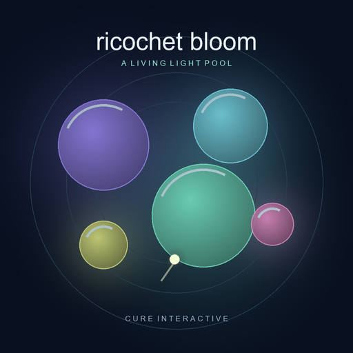

# Ricochet Bloom

**A living light pool.** A blobby physics-and-sound browser game by Cure Interactive.

[Play Ricochet Bloom](https://cure-interactive.github.io/game-ricochet-bloom/)

Drag backward and release to pluck a luminous seed through drifting jellies. Five different jelly touches form a bloom. Make three blooms before your twelve plucks run out, or choose Free play to keep shaping the music. Successful plucks unlock up to three contact powers per shot; twenty-four powers change how the pool moves.

Your plucks supply melodic ideas and your bloom chords build the accompaniment into a song. Headphones are recommended. Sound starts after you enter the pool; volume and ambience have separate controls. Gentle visuals is optional.

Keyboard: Left/Right aim, Up/Down adjust power, Space plucks, and P pauses. Touch and mouse dragging work directly on the pool. Saves stay in your browser and are separate from other hosted copies.

## Hosting

This repository is the static playable edition, published with Git Repository Publish. GitHub Pages serves `main` from the repository root over HTTPS. All runtime assets use relative paths, including the bundled font, SVG power icons, and media artwork. No dependency installation or build is required; serve this directory with any static web server for local development.

## Credits

Original procedural light, artwork, physics, and synthesized sound by Cure Interactive. Fredoka is bundled unmodified under the [SIL Open Font License](font/fredoka/OFL.txt). No external audio recordings, analytics, or advertising are used.

Copyright © 2026 Cure Interactive. All rights reserved except separately licensed font assets.

### Shape and keep your music

Jellies are marked for melody (♪), bass (≋), and rhythm (⋮). Actual contacts develop separate memories as the song layers unlock. Glass, Velvet, and Wood palettes change the shared instruments; impact strength changes articulation. Banked blooms and bonus objectives earn occasional phrase-boundary fills, breathing room, and returns. Bonus objectives are always active in both modes, including restored pools. The main-screen card shows live requirements, progress and the +200 reward; tap it for details and the next target. Objectives rotate through a banked bloom, seven unique hits, and a bank with two powers, awarding 200 points once per pluck. The aim guide previews the first wall rebound and stops at the next wall; moving jellies can change the actual path. Shot feedback reports notes, banks, powers and points.

Song library saves up to 24 named favorites independently of the current pool, in this browser only. Select a favorite to rename it or prepare a 26-second stereo WAV highlight using the same composer and instruments. Playback does not replace your pool. Download WAV works independently of native file sharing; Share audio appears only when the browser supports it and opens its own share sheet. Clearing browser storage removes favorites, so export keepsakes first. Live ambience continues evolving; the finite highlight is only an export.

Your plucks automatically shape the song. A three-hit pluck establishes a recurring melody. It repeats for eight bars, then fresh melody-jelly hits can change one half at the next section while the other half stays familiar. Short shots still get musical replies; misses never erase the song. Bass and rhythm ideas join at two-bar boundaries. Older saved hooks and favorites are preserved as starting melodies.

The screen-filling layout keeps play and controls visible without page scrolling. Open Settings, Powers or Music for secondary controls; their panels scroll independently. Add the page to your Home Screen to use its standalone display and bloom icon.

Interface controls use SVG artwork from Cure Interactive Icons, with a small set of original game fallbacks. Settings → Icon credits links to each bundled attribution and full license. See [the icon inventory](icon/ui/INDEX.md).

Relay-armed jellies can activate powers on the jellies they bump. Each Relay jelly has one transfer; power collection uses the shared allowance and refreshes the player flight. A marked jelly that has already scored still activates its power without scoring twice.

Homing curves your seed and Split seeds toward nearby unhit jellies ahead for five seconds. Green brackets mark the current target; steering preserves speed apart from ordinary water drag.
